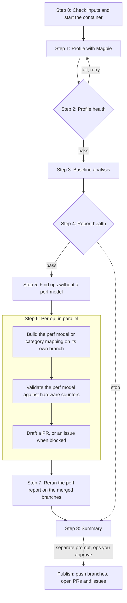

<!--
Copyright (c) 2026 Advanced Micro Devices, Inc. All rights reserved.

See LICENSE for license information.
-->

# TraceLens Model Bringup Agent

The [model-bringup skill](skills/model-bringup/SKILL.md) brings a new model up on TraceLens. It profiles the model with the [Magpie profiling skill](../Profiling/README.md) and runs the [analysis orchestrator](../Analysis/README.md) on the trace. For each op that takes a large share of kernel time and has no perf model, it drafts a validated perf model, a category mapping or an issue for you to review. It supports SGLang, vLLM and ATOM, fixed-sequence and AgentX workloads on AMD GPUs.

## Prerequisites

### 1. Install TraceLens

Install TraceLens where the agent runs, as in the [Profiling README](../Profiling/README.md#1-install-tracelens), so the runner finds the skill.

### 2. Check out Magpie

Check out [Magpie](https://github.com/AMD-AGI/Magpie).

## Quick Start - How to Use

1. Create a template [templates/bringup_config.yaml](skills/model-bringup/templates/bringup_config.yaml). Each key and option is described under [Placeholders](skills/model-bringup/reference.md#placeholders). For example, a fixed-sequence SGLang run with no benchmark YAML:

   ```yaml
   node: <gpu_node>
   magpie_dir: <path>/Magpie
   tracelens_dir: <path>/TraceLens
   tracelens_internal_dir: <path>/TraceLens-internal
   bringup_dir: <path>/bringup/<run_name>

   benchmark_yaml:

   model: <hf_org>/<hf_model>
   framework: sglang
   docker_image: <serving_image>:<tag>
   hf_cache_path: <path>/hf_cache
   workload: fixed_seq
   workload_params:
     tp: 1
     conc: 32
     isl: 1024
     osl: 1024
   ```

2. Invoke the agent:

   ```text
   Follow the model-bringup skill installed with TraceLens and run it from config <path>/bringup_config.yaml
   ```

   Without a config, the agent first asks for the inputs one at a time.

   The agent starts a container on the node with your TraceLens checkouts installed and profiles the model with Magpie. It checks the trace, reprofiling if the check fails, then runs the baseline analysis and checks the perf report. Next it picks the ops that take at least 2% of kernel time by default and have no perf model. For each one, a sub-agent builds and validates a perf model or category mapping on its own branch and drafts a PR or issue. Finally it merges those branches, reruns the perf report to confirm the new coverage and writes the summary. Any other failed check stops the run and goes straight to the summary.

3. Results: The agent replies with the bringup summary. Everything else is in the bringup dir. Scan it in this order:

   - `bringup_summary.md`: the status of each gate and the outcome and reason for each op. It ends with the Publish prompt when any op has a draft. Start here.
   - `analysis/analysis.md`: the baseline analysis report for the model.
   - `perf_models/<op_slug>/`: one folder per op. The draft is `perf_model_pr.md` or `perf_model_issue.md`, and `validation/` holds the validation CSV behind it. A blocked op that needed a pseudo op also has `pseudo_op_check.md`.
   - `worktrees/pm_<op_slug>/`: the op's branch checked out, to inspect or amend the code before publishing.
   - `coverage/`: the perf report rerun with the new perf models and category mappings merged.
   - `profile/attempt_<n>/` and `profile_check/`: the profiling runs and their trace checks. Look here when an early gate fails.

4. Publish: Review the drafts, then send the Publish prompt from the end of the summary as a follow-up command, keeping only the ops you approve.

## Workflow


